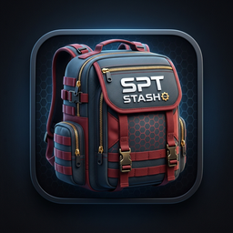
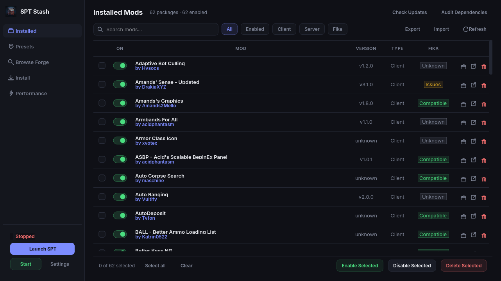
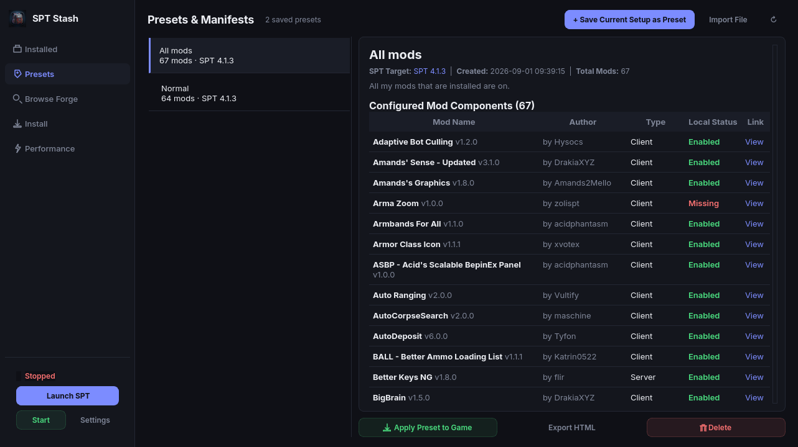
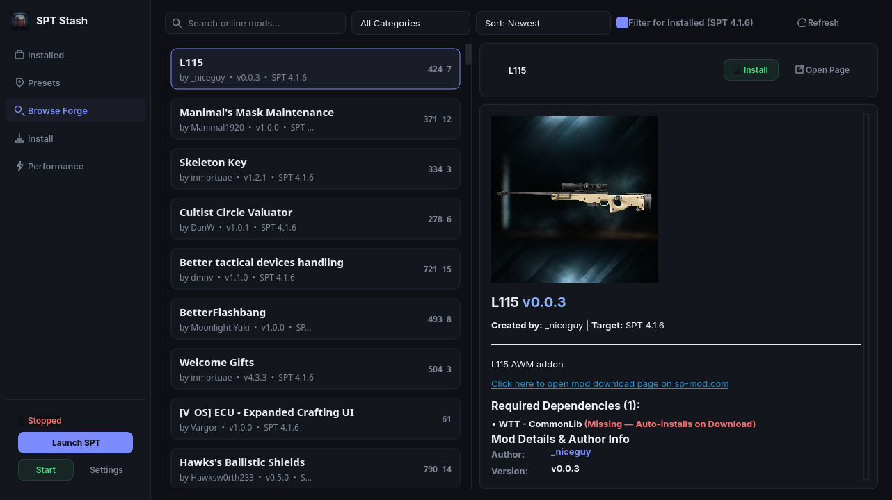
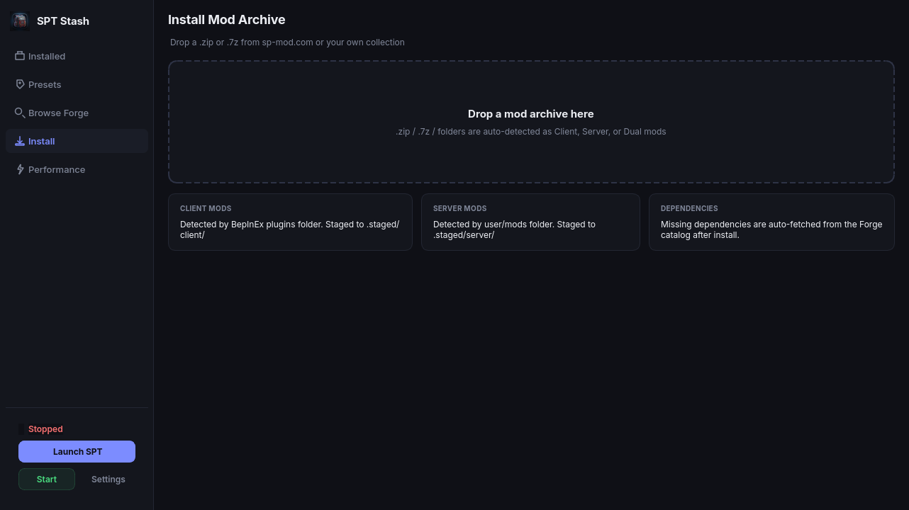
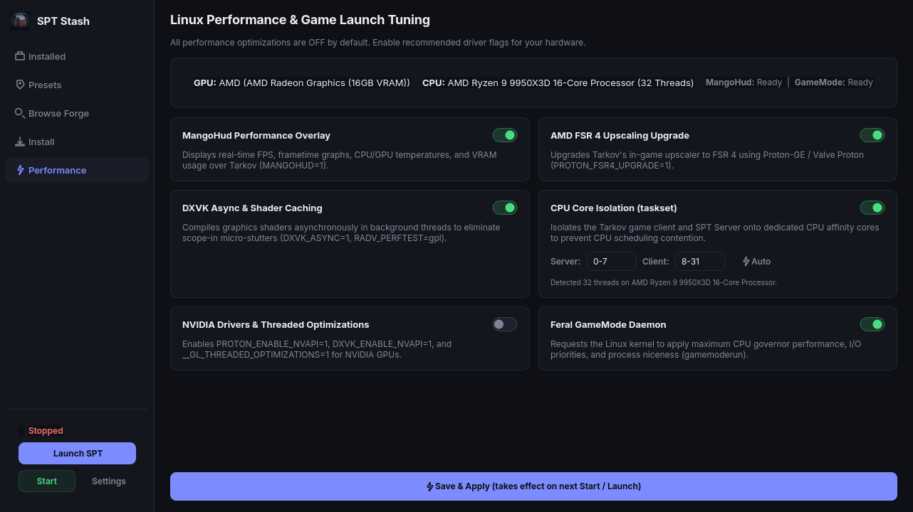

#  SPT Stash

> **Native Linux mod manager and performance suite for Single-Player Tarkov (SPT)**

[](https://github.com/j-cardell/spt-stash/actions/workflows/ci.yml)
[](https://github.com/j-cardell/spt-stash/actions/workflows/appimage.yml)
[](LICENSE)

**SPT Stash** is a desktop app for running Single-Player Tarkov on Linux and Steam Deck. It manages your mods with symlinks, browses and installs from the [sp-mod.com Forge](https://sp-mod.com), starts and stops the SPT server, launches the game, and applies Linux performance tuning when you do.

---

## Features

- **Symlink staging**: every mod lives once in `.staged/`. Enabling or disabling a mod adds or removes a relative symlink in `BepInEx/plugins` or `user/mods`, so it is instant and nothing is copied or re-downloaded.
- **Picks up hand-installed mods**: mods you dropped into `BepInEx/plugins` or `user/mods` yourself are moved into the stash and linked back, so they show up and can be toggled like any other.
- **Bulk actions**: select several mods and enable, disable, or delete them together.
- **Update checker**: compares installed versions against the Forge catalog and can update everything in one go. Mods with no known version are offered the update.
- **Dependency audit**: finds missing or disabled dependencies and offers to fix them.
- **Forge browser**: search and filter the catalog (five sort modes, target SPT version), then install with automatic dependency handling. Downloads and installs show progress in a bar at the bottom of the window, and rate limits from the site are retried automatically.
- **Presets**: save the set of enabled mods as a preset, apply it later (missing mods are downloaded for you), and export or import presets as HTML manifests.
- **Local archive installer**: install a `.zip` or `.7z` you already have. Windows-style paths are handled.
- **Server control**: start and stop the server from the sidebar, with a live status badge read from `http.json`. If the launcher or game is still open when you stop the server, you get a warning first.
- **Performance tab**: MangoHud, FSR 4, DXVK async, NVIDIA options, GameMode, and CPU core pinning with `taskset`. The settings are applied every time you start the server or launch SPT. Your launch scripts are never rewritten.
- **Greed.exe (SVM)**: run the official Server Value Modifier configurator under Proton or Wine, in a prefix you choose.
- **Fika compatibility badges** and clickable author profile links.
- **Update notice**: on startup the app asks GitHub for the latest SPT Stash release. If it is newer than the one you're running, an "Update available" button appears in the sidebar and opens the release page. Nothing is downloaded or replaced automatically. To turn the check off, set `"check_app_updates": false` in `config.json`.

---

## Screenshots

### Installed mods
Toggle mods on or off, filter by type or Fika status, run bulk actions, check for updates, and audit dependencies.



---

### Presets
Save, apply, export, and import loadouts. The detail view shows which mods in a preset are enabled or missing.



---

### Browse the Forge
Search sp-mod.com, filter by category and SPT version, and install with dependencies resolved for you.



---

### Install a local archive
Drop in or choose a `.zip` or `.7z`. Client and server components are detected and staged automatically, including root-level files such as `Unity.VectorGraphics.dll` or `Greed.exe`.



---

### Performance
GPU and CPU are detected automatically. Pick the tweaks you want, then save. They take effect the next time you start the server or launch SPT.



---

## Requirements

- Python 3.10+ and PySide6 if you run from source (the AppImage and binary bundle both).
- The SPT 4.x server needs the **.NET 10 runtime and the ASP.NET Core 10 runtime** installed on the host. On Arch-based distros that is `dotnet-runtime-10.0` and `aspnet-runtime-10.0`.
- `p7zip` (`7z`) to install `.7z` archives.
- Optional, for the Performance tab: `mangohud`, `gamemode` (plus `lib32-gamemode` or your distro's 32-bit equivalent), and `taskset`.
- Optional, for Greed.exe: `umu-launcher` and a Proton build such as GE-Proton, or Wine.

---

## Settings

Click **Settings** in the sidebar to configure paths:

| Setting | Description | Example |
| :--- | :--- | :--- |
| **SPT Installation Folder** | Root of your SPT install, the folder containing `BepInEx` and `SPT_Runtime`. Do not pick your Wine/Proton prefix. | `~/Games/SPT` |
| **Mod Staging Stash Directory** | Where SPT Stash keeps your mods. Enabled mods are symlinked from here into the game. | `~/Games/SPT/.staged` |
| **Start Server Script Path** | The program or script that starts the SPT server. | `~/Games/SPT/SPT_Runtime/SPT.Server.Linux` |
| **Launch SPT / Launcher Script Path** | The program or script that starts the SPT launcher. | `~/Games/SPT/SPT_Runtime/SPT.Launcher.Linux` |
| **Wine / Proton Prefix** (optional) | An existing prefix to run `Greed.exe` in (for example one that already has the .NET Desktop Runtime), or a folder where a new one is created. Blank means auto-detect. | `~/Games/SPT-Prefix` |
| **Proton / Compatibility Runner** | Which Proton or GE-Proton build, or system Wine, runs Windows tools. | `Auto-Detect (GE-Proton11-6)` |
| **Launch Greed.exe (SVM)** | Starts `Greed.exe` from your SPT folder. The button shows "Launching..." while umu starts. If SVM is not installed it offers to open the Forge tab with the search filled in. | button |
| **Create Desktop Shortcut** | Adds SPT Stash to your application menu. | button |

If the server or launcher path doesn't exist when you click Start or Launch SPT, a warning tells you to fix it in Settings.

### Greed.exe (SVM)

SPT Stash runs the official [Server Value Modifier](https://sp-mod.com/mod/236/server-value-modifier-svm) configurator instead of reimplementing it:

- It runs from your SPT folder, so it sees all your installed server mods.
- If `Greed.exe` is in the staged SVM mod, it is copied to the SPT root and the mod is linked into `user/mods`.
- Pick a specific Proton build, auto-detect the newest GE-Proton, or use system Wine. Point it at an existing prefix if you already have one set up.

### Where things are stored

| What | Location |
| :--- | :--- |
| Config | `~/.config/spt-mod-manager/config.json` |
| Presets | `~/.config/spt-mod-manager/presets/` |
| Mod stash | `<SPT folder>/.staged/` (`client/` and `server/`) |
| Catalog cache | `~/.cache/spt-mod-manager/catalog.json` |
| Image cache | `~/.cache/spt-mod-manager/images/` |
| Download cache | `~/.cache/spt-mod-manager/downloads/` |

---

## Installation

### AppImage (recommended)
Download `SPT_Stash-x86_64.AppImage` from [GitHub Releases](https://github.com/j-cardell/spt-stash/releases):

```bash
chmod +x SPT_Stash-x86_64.AppImage
./SPT_Stash-x86_64.AppImage
```

It is built on Ubuntu 22.04, so it needs **glibc 2.35 or newer** (Debian 12+, Ubuntu 22.04+, and most current distros).

### Standalone binary
Releases also include a single `spt-stash` executable, with no AppImage wrapper and no Python needed:

```bash
chmod +x spt-stash
./spt-stash
```

### From source

```bash
git clone https://github.com/j-cardell/spt-stash.git
cd spt-stash
pip install PySide6 certifi
python3 spt_mod_manager.py
```

### Desktop shortcut
To add SPT Stash to your application menu, run `python3 install_desktop_shortcut.py`, or click **Create Desktop Shortcut** in Settings.

---

## Development

```bash
python3 run_tests.py   # lint plus headless unit tests
ruff check             # linter only
```

---

## License
MIT. See [LICENSE](LICENSE).
